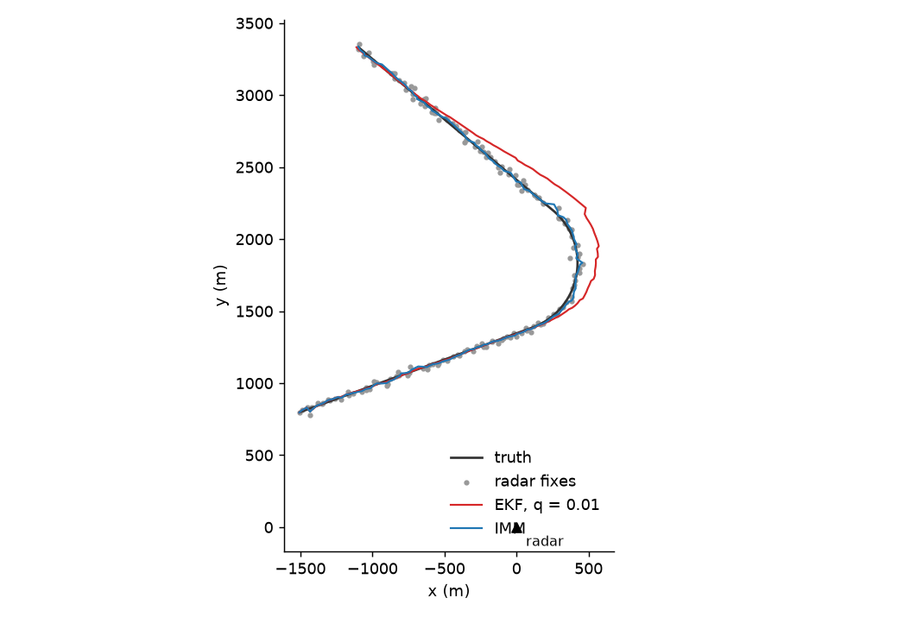
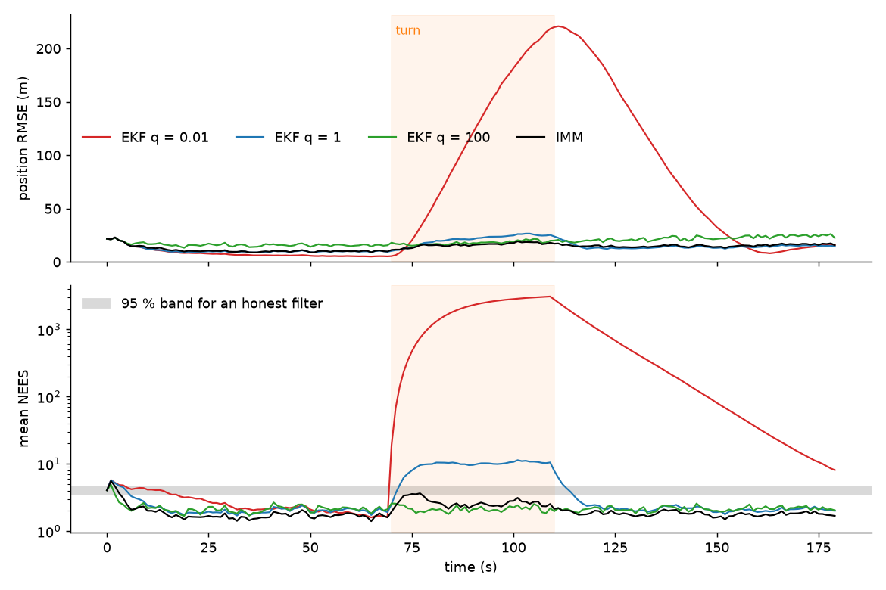

# kalman-tracker

*Built with the help of Claude Code.*

Tracking a moving target from a ground radar: a Kalman filter, an extended
Kalman filter, and an interacting multiple model (IMM) filter, written from
scratch in NumPy. The comparison looks at two things: how accurate each
filter is, and whether it *knows* how accurate it is.

The target flies straight, makes a 120° turn at 3°/s, and flies straight
again. The radar at the origin measures range (±15 m) and bearing (±0.5°)
once per second and misses the target 10 % of the time.



## Results (100 Monte Carlo runs)

| filter | position error, straight | position error, turn | mean NEES (honest ≈ 4) |
|---|---:|---:|---:|
| raw radar fixes | 24.5 m | 21.6 m | - |
| Kalman filter on converted fixes, q = 1 | 12.4 m | 21.4 m | 3.9 |
| extended Kalman filter on range/bearing, q = 1 | 12.4 m | 21.4 m | 3.9 |
| **IMM (cruise q = 0.1 + manoeuvre q = 30)** | 13.3 m | **16.1 m** | 2.0 |

### The tuning problem

A constant-velocity filter has one knob, the process noise `q`: how much
unexplained acceleration to expect. Sweeping it:

| q | error straight | error turn | NEES straight | NEES turn |
|---:|---:|---:|---:|---:|
| 0.01 | 71.4 m | 133.6 m | 154 | 1930 |
| 0.1 | 15.8 m | 55.8 m | 5.1 | 139 |
| 1 | 12.4 m | 21.4 m | 2.1 | 9.5 |
| 10 | 15.6 m | 15.4 m | 2.1 | 2.5 |
| 100 | 19.5 m | 18.1 m | 2.1 | 2.1 |



A small `q` smooths beautifully in straight flight, then loses the target
in the turn by 200 m. Worse, the filter is sure of itself the whole time.
NEES (normalised estimation error squared) measures that: it compares the
actual error with the covariance the filter reports. An honest 4-state filter
averages 4. The q = 0.01 filter reaches NEES in the thousands, meaning it
claims to be accurate to a few metres while it is 200 m off. That matters
more than the error itself. Anything downstream (gating the next
measurement, fusing with another sensor, deciding whether two tracks are the
same target) trusts that covariance.

A large `q` stays honest in the turn but is noisy everywhere else. No single
setting is good at both.

The IMM runs two filters side by side, a calm one and an agile one. After
each measurement, it updates how likely each model is given how well it
predicted that measurement, and blends their estimates accordingly. In
straight flight the agile model's weight sits around 0.2. In the turn it
rises to about 0.5. The result is close to the best single filter in
straight flight, 25 % better in the turn, and it never becomes overconfident.

### Why KF and EKF tie here

The EKF takes range and bearing directly and linearises around its estimate.
The KF converts each fix to x, y first, with the covariance rotated along
the line of sight. At these ranges (1–4 km) and with 0.5° of bearing noise,
the conversion is almost exactly linear, so both give the same answer. The
difference shows up at long range with poor bearing accuracy. There the
converted fixes are biased (the average of noisy bearings lies inside the
true arc), and the EKF, or better an unscented filter, is the right choice.

## Code

```
src/tracker/
  simulate.py   trajectory with a coordinated turn, radar with noise and missed detections
  filters.py    CartesianKF, RadarEKF, IMM; two-point initialisation
  evaluate.py   Monte Carlo runs, RMSE and NEES, figures
```

Details worth pointing out:
- covariance update in Joseph form, so P stays symmetric and positive definite
- bearing innovations wrapped to [-π, π), otherwise a target crossing the
  ±180° line makes the filter jump
- missed detections are predict-only, so uncertainty grows while the radar is blind
- 95 % NEES band from the chi-square distribution with 4 × 100 degrees of freedom

```
pip install -e .[dev]
python -m tracker.evaluate --plot
pytest
```

## Next steps

- A coordinated-turn motion model inside the IMM instead of a noisier
  constant-velocity model. It would track the turn itself, not just tolerate it.
- Several targets and clutter: data association (nearest neighbour, then JPDA).
- Fusing a second sensor, e.g. a camera bearing, with the same filter.
